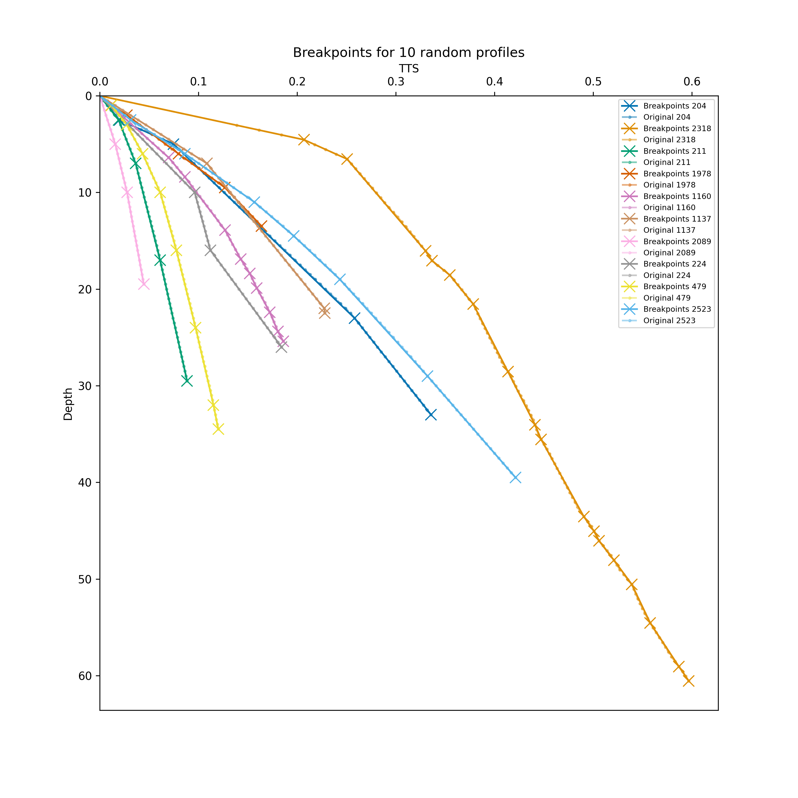
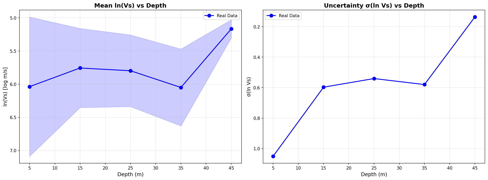
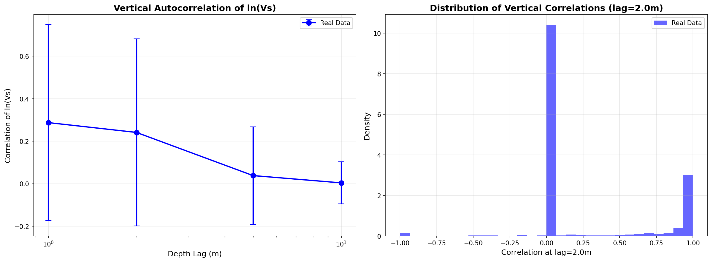

# Generative AI project on Spatial-Correlated Soil Profiles

[](https://github.com/KurtSoncco/gen-ai-soil-profiles)
[](https://www.python.org/)
[](https://github.com/KurtSoncco/gen-ai-soil-profiles/actions)
[](https://github.com/astral-sh/uv)
[](https://opensource.org/licenses/MIT)
[](https://github.com/KurtSoncco/gen-ai-soil-profiles/stargazers)

This repository explores generative AI techniques for synthesizing realistic, spatially-correlated shear-wave velocity (Vs) soil profiles for geotechnical and seismic-hazard applications. It progresses from closed-form parametric/stochastic baselines to deep generative models (VAE, GAN) and a **Transformer conditional flow-matching** model that generates variable-length profiles from real borehole data. On the one-way benchmark, that Transformer is the model under test, not the best score.

[Research Questions](#-research-questions--hypothesis) • [Methodology](#️-methodology) • [Flagship Model](#-flagship-model-transformer-conditional-flow-matching) • [Data](#-data) • [How to Reproduce](#-how-to-reproduce) • [Key Results](#-key-results)

---

## 🎯 Research Questions / Hypothesis

- Can a generative model learn a realistic, physically-plausible distribution of Vs(z) profiles — including their vertical (depth-wise) spatial correlation structure — directly from real borehole measurements?
- Does representing a profile as a variable-length sequence of layer "breakpoints" (rather than a fixed-length vector) let a single model handle profiles of arbitrary depth and layering complexity?
- Do physics- and geostatistics-informed loss terms (velocity bounds, depth-dependent statistics, vertical autocorrelation) measurably improve the realism of generated profiles over an unconstrained baseline?

---

## 🛠️ Methodology

The repo is organized as a progression of experiments, each in its own directory under [`experiments/`](experiments/), moving from simple closed-form baselines toward increasingly expressive, data-driven, physics-aware generative models:

| Approach | Directory | Profile representation | Model family | Role |
|---|---|---|---|---|
| Parametric curves | [`experiments/parametric`](experiments/parametric) | Exponential / power-law / layered function params | GMM, MLP-VAE over parameters | Interpretable baseline |
| Stochastic sampling | [`experiments/stochastic_approach`](experiments/stochastic_approach) | Two-way travel time (TWT) vs. depth | Bayesian power-law (NumPyro MCMC), Genetic Algorithm | Uncertainty-aware baseline |
| Deep generative (fixed-length) | [`experiments/VAE`](experiments/VAE), [`experiments/conv1d_gan`](experiments/conv1d_gan) | Fixed-length, resampled Vs(z) vector | Conv1D VAE / VQ-VAE, Conv1D GAN | Quantitative benchmark (published metrics, see below) |
| Flow matching feasibility studies | [`experiments/synthetic_toy_profiles_flow_matching`](experiments/synthetic_toy_profiles_flow_matching), [`experiments/vs_pairs_flow_matching`](experiments/vs_pairs_flow_matching) | 2-layer toy profiles / 4D [vs30, vs50, vs100, vs200] | UNet & FNO / MLP & FNO unguided flow matching | Validate flow matching mechanics before scaling up |
| **Transformer Flow Matching** | [`experiments/flow_matching_simplified`](experiments/flow_matching_simplified) | **Variable-length [one-way travel time, depth] breakpoint tokens** | **Transformer conditional flow matching** | **Variable-length model under test** |

Older experiments in this table treat Vs as approximately log-normal and train on `log1p(Vs)`, mapping outputs back with `expm1`. The Transformer does not. Its tokens are raw one-way travel time and depth. Layer velocity is `Vs = Δz / Δt`.

---

## 🌊 Flagship Model: Transformer Conditional Flow Matching

[`experiments/flow_matching_simplified`](experiments/flow_matching_simplified) is the variable-length model under test. It generates full-depth Vs profiles for real boreholes. On the one-way benchmark below, a fixed-grid Gaussian and a fixed-grid flow match or beat it. Variable length is a representation, not a performance claim.

### Why Flow Matching
Conditional Flow Matching trains a neural vector field `v_θ(u, t)` to transport samples from a noise distribution at `t=0` toward real data at `t=1`, with a regression loss rather than an adversarial objective or an evidence lower bound. The numbers reported here use Euler integration with 50 steps. RK4 was swept on the same checkpoint and is not the headline integrator. See [`docs/stage3_baseline_clean.md`](docs/stage3_baseline_clean.md).

### Key techniques
- **Breakpoint tokenization**: each profile is a variable-length sequence of `[one-way travel time, depth]` pairs at layer boundaries. One-way travel time of a layer is `Δt = h / Vs`. Inversion is `Vs = Δz / Δt`. This is the Passeri definition used by the flagship. A factor of 2 does not belong in that formula.
- **Per-profile normalization + sequence-stats conditioning**: each token sequence is z-score normalized using its *own* mean/std (so the network operates in a consistent unit-scale space), while the original `[ts_mean, ts_std, depth_mean, depth_std]` are fed back in as a conditioning vector — letting the model reconstruct each profile's absolute scale.
- **Transformer encoder + sinusoidal time embedding**: a 4-layer, 8-head Transformer (256-dim) with positional encoding across breakpoint order, conditioned on a sinusoidal embedding of the flow-matching time variable `t`.
- **Depth convolution block**: a shallow 1D convolution (kernel size 3) applied along the depth/layer axis with a residual connection, added specifically to improve short-lag (1–2 m) vertical coherence between neighboring layers.
- **Physics penalty**: on the interpolated state `ut`, with weight `1e-2`. It uses the same `Vs = Δz / Δt` as evaluation, skips non-positive increments, and clips Vs before the penalty. This term can affect `v_θ`. It does not by itself keep sampled profiles inside [100, 5000] m/s. The Stage 3 Euler-50 bound rate is 0.675.
- **Geostatistics terms**: a depth-statistic loss and a vertical-correlation loss are added during training. Both are computed on the real batch, then rebuilt from NumPy, so they do not train `v_θ`. Validation and the learning-rate schedule use the flow-matching loss only. The stored correlation targets are 0.0135 at 1 m and 0.0524 at 2 m. The eval correlation on real test profiles is 0.993 at 1 m, from a different estimator. Details are in [`docs/stage7_bound_and_correlation.md`](docs/stage7_bound_and_correlation.md).

### Assumptions
- A modest number of piecewise-linear breakpoints (≤ 20 layers) is an adequate approximation of real Vs(z) stratigraphy; continuously-varying profiles (e.g. CPT-derived) would lose fidelity under this representation.
- Depth-binned `ln(Vs)` mean/std and vertical autocorrelation are treated as approximately stationary within a depth bin across the profile population — a standard simplifying assumption borrowed from geostatistics, not a claim that soil is literally homogeneous.
- Per-profile normalization assumes each profile's scale is fully recoverable from four summary statistics; this is what makes the sequence-stats conditioning vector necessary.
- Vs is bounded to [100, 5000] m/s, based on physically plausible shear-wave velocities for near-surface soil and rock.

### Figures


*Figure 1 — Ten real profiles (dots) reduced to their piecewise-linear breakpoint tokens (X markers) in travel-time/depth space. This variable-length breakpoint sequence is the input representation learned by the flow matching model.*


*Figure 2 — Depth-binned mean and standard deviation of `ln(Vs)` computed from real VSPDB profiles. These are the stored depth-statistic targets. That loss does not train the vector field.*


*Figure 3 — Empirical vertical autocorrelation of `ln(Vs)` vs. depth lag (left), and its full distribution at a 2 m lag (right). This is the layer-center statistic stored as a training target. It is not the 0.5 m-grid correlation used in evaluation.*

The Transformer follows two smaller flow-matching studies, [`synthetic_toy_profiles_flow_matching`](experiments/synthetic_toy_profiles_flow_matching) and [`vs_pairs_flow_matching`](experiments/vs_pairs_flow_matching). Checkpoints, parquets, and result JSON are gitignored. The numbers in [Key Results](#-key-results) are the record of the runs already completed. A fresh clone does not contain those weights.

---

## 💾 Data

- **Primary source**: the [Vs Profile Database (VSPDB)](https://www.vspdb.org), a repository of real geotechnical shear-wave velocity measurements, fetched via an authenticated API client ([`scripts/vspdb_request_data.py`](scripts/vspdb_request_data.py), [`soilgen_ai/apis`](soilgen_ai/apis)). Credentials (`AUTH_VSPDB_API_EMAIL`, `AUTH_VSPDB_API_PASSWORD`) are read from a local `.env` file and are **not** committed to the repo.
- A secondary Japanese Vs profile dataset is supported via [`scripts/japan_data.py`](scripts/japan_data.py).
- Synthetic datasets used for the flow matching feasibility studies are generated locally: [`scripts/generate_synthetic_profiles.py`](scripts/generate_synthetic_profiles.py) (2-layer toy profiles) and [`scripts/extract_vs_pairs.py`](scripts/extract_vs_pairs.py) (4D Vs-pair summaries extracted from full profiles).
- The Transformer is trained on one-way breakpoints. `compute_tts` writes `Δt = h / Vs`. The one-way files are `data/vspdb_tts_profiles_onewaytime.parquet` and `experiments/flow_matching_simplified/data/breakpoints_onewaytime.parquet`. The older `data/vspdb_tts_profiles.parquet` still stores doubled travel time and is left in place so the failing legacy test documents that bug. Rebuild with `python -m experiments.flow_matching_simplified.regenerate_onewaytime`. Some other experiments still describe two-way time; do not use that convention for the Transformer.
- Raw data is intentionally **not committed to Git** (`data/` only tracks a `.gitkeep`); reproduce it locally using the scripts above.

---

## 🚀 How to Reproduce

1.  **Clone the repository:**
    ```bash
    git clone https://github.com/KurtSoncco/gen-ai-soil-profiles.git
    cd gen-ai-soil-profiles
    ```
2.  **Create and activate a virtual environment using `uv`:**
    ```bash
    pyenv local 3.11
    uv venv
    source .venv/bin/activate
    ```
3.  **Sync dependencies using `uv`:**
    ```bash
    uv sync --extra dev
    ```
4.  **Run the test suite:**
    ```bash
    pytest
    ```
5.  **Fetch/prepare data** (requires VSPDB credentials in `.env` for real profiles):
    ```bash
    python scripts/vspdb_request_data.py
    python scripts/extract_vs_pairs.py               # for the Vs-pairs feasibility experiment
    python scripts/generate_synthetic_profiles.py     # for the toy-profile feasibility experiment
    ```
6.  **Rebuild one-way breakpoints and train the Transformer** (about 80 minutes for 1,000 epochs on the machine used here; weights are written under `outputs/` and are not in git):
    ```bash
    python -m experiments.flow_matching_simplified.regenerate_onewaytime
    python -m experiments.flow_matching_simplified.train_onewaytime
    ```
7.  **Score a local checkpoint** with the one-way files. The default travel-time parquet is the legacy doubled file, so pass the one-way paths:
    ```bash
    python -m experiments.flow_matching_simplified.run_corrected_eval \
      --breakpoints experiments/flow_matching_simplified/data/breakpoints_onewaytime.parquet \
      --tts data/vspdb_tts_profiles_onewaytime.parquet \
      --checkpoint-dir outputs/flow_matching_simplified_onewaytime/checkpoints \
      --output outputs/flow_matching_simplified/results/corrected_eval_onewaytime.json
    ```
    Other experiments (VAE, Conv1D GAN, parametric, stochastic) each have their own `run_experiment.py` and README — see the table in [Methodology](#️-methodology).

---

## 📊 Key Results

Headline rows are Euler integration, 50 steps, 200 samples, on the seed-42 test split (1,895 / 236 / 238). Inversion is `Vs = Δz / Δt`. The full tables, intervals, and the RK4 sweep are in [`docs/stage3_baseline_clean.md`](docs/stage3_baseline_clean.md). The structured-prior decision is in [`docs/stage6_structured_prior_stage1.md`](docs/stage6_structured_prior_stage1.md).

| Model | Trend RMSE | Bound rate | Corr 1 m | Gap 1 m | Pairwise |
|---|---|---|---|---|---|
| Real test profiles | — | 0.950 | 0.993 | — | 708 |
| Fixed-grid Gaussian | 0.228 | 0.945 | 0.994 | 0.001 | 545 |
| Transformer, `latest`, Euler 50 | 0.272 | 0.675 | 0.964 | 0.029 | 524 |

The Gaussian matches the real 1 m and 2 m correlation and has the higher bound rate. The Transformer is one training seed. `best.pt` (epoch 449) has no profiles from 130 m to 200 m in that draw, so it is not ranked.

A Gaussian-trend structured prior, three seeds, did not beat this flagship or the Gaussian on 1 m correlation, 2 m correlation, or pairwise distance. Trend RMSE stayed at or below 0.272. Seeds 42 and 44 fell below the 0.675 bound-rate floor (0.625 and 0.595); seed 43 was 0.680. The prior, as specified, is dropped. A fixed-grid MLP, also three seeds, beat the single flagship value and the single Gaussian value on 1 m and 2 m correlation and held bound rates from 0.990 to 1.000. That comparison does not yet recommend the model class. A conference outline and the ablation list are in [`docs/conference_outline.md`](docs/conference_outline.md).

The Conv1D VAE ([`experiments/VAE`](experiments/VAE)) reports a different metric, Vs30, and is not a head-to-head score against the table above:

| Metric | Real | Generated |
|---|---|---|
| Vs30 mean (m/s) | 219.28 | 221.84 |
| Vs30 std (m/s) | 132.96 | 115.83 |
| KS statistic (Vs30 distribution) | — | 0.0959 (good match) |
| Mean ratio (generated/real) | — | 1.0117 |
| Std ratio (generated/real) | — | 0.8712 |
