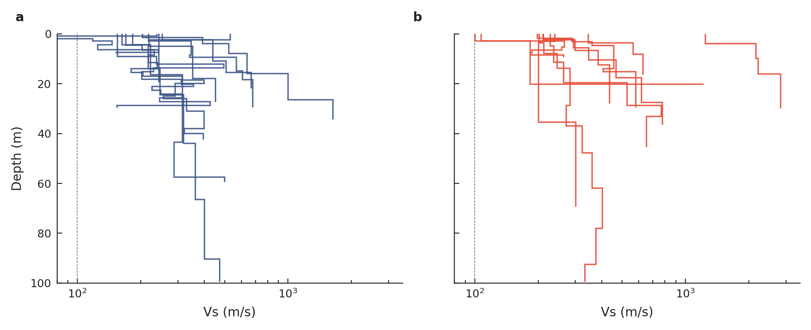
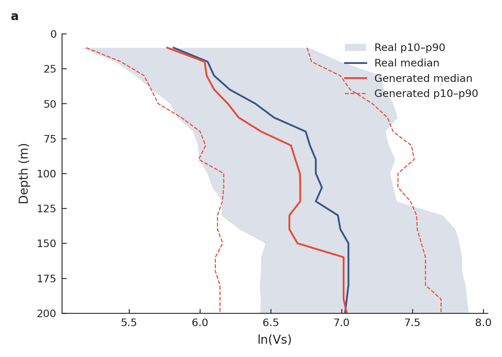
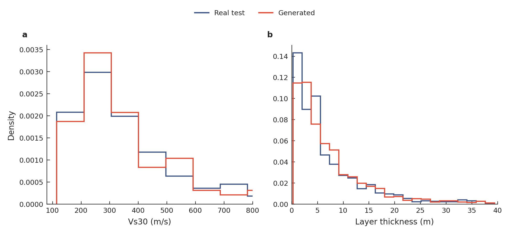

# Generative models for 1D shear-wave velocity profiles

[](https://www.python.org/)
[](https://github.com/KurtSoncco/gen-ai-soil-profiles/actions)
[](https://opensource.org/licenses/MIT)

This repository studies generative models of **one-dimensional** shear-wave velocity profiles \(V_s(z)\). It does not generate a spatial (map) random field. The current model is a Transformer conditional flow matcher on per-layer tokens, with thicknesses that sum to a conditioned depth and \(V_s\) inside [100, 5000] m/s. Earlier work in the same repo includes parametric baselines, a Conv1D VAE/GAN, and a cumulative travel-time flow that is kept only as a negative control.

[Abstract](#abstract) · [Current model](#current-model) · [Data](#data) · [Results](#results) · [Limits](#what-this-is-not) · [Reproduce](#how-to-reproduce) · [Earlier experiments](#earlier-experiments) · [Write-ups](#write-ups) · [References](#references)

## Abstract

Shear-wave velocity profiles are layered and constrained: thicknesses are positive, \(V_s\) is bounded, and adjacent layers are correlated. The first Transformer in this repo generates cumulative travel time and depth. About one sample in five is invalid. Its physics and correlation losses never reach the network. The usual 0.5 m-grid correlation mostly measures thickness and favors a Gaussian that copies borehole boundaries.

The current model uses the same Transformer and changes the tokens. Each token is one layer. Thicknesses decode as \(h=\mathrm{softmax}(u)\cdot H\); \(V_s\) is mapped into [100, 5000] m/s. The condition is total depth, layer count, and time-averaged \(V_s\) to 30 m (or to \(H\)). Training starts from a Toro (1995) profile with the same \(n\) and \(H\), so the flow learns a correction to that randomization.

The catalog is 2,369 VSPDB profiles cut to at most 20 breakpoints (1,895 / 236 / 238). Three seeds: every sample valid, Vs30 median 303–318 m/s against 309, residual inter-layer \(\rho\) 0.790–0.799 against 0.772 (fitted Toro 0.774), and a better depth trend than Toro. A 50/50 Toro–Gaussian start hits \(\rho\) 0.765–0.788 and doubles trend error. Generated \(f_0\) matches train (8 Hz), not test (9.5 Hz).

This is a **Vs30- and \(H\)-conditional generator of the 20-layer catalog**, not a regional site field. VSPDB is pooled and unlabeled; median depth is 30 m. More anonymous 30 m logs will not unmix regions.

## Current model

Code: [`experiments/flow_matching_simplified/train_constrained.py`](experiments/flow_matching_simplified/train_constrained.py). Same backbone as the earlier flagship: 4-layer, 8-head Transformer, hidden size 256, about 3.4 M parameters, Euler 50 steps.

| Piece | What it does |
|---|---|
| Tokens | One per layer: log thickness fraction and bounded \(\ln V_s\) |
| Decoder | \(h = \mathrm{softmax}(u)\cdot H\); \(V_s\) in [100, 5000] m/s by construction |
| Condition | \(\ln H\), layer count, \(\ln V_{s,z}\) (Vs30 if \(H \ge 30\) m), drawn jointly from one training profile |
| Source \(x_0\) | Toro (1995) fitted on train, remapped to the same \(n\) and \(H\); `--toro-source-frac` mixes with Gaussian noise |
| Penalty | Thin-layer term on the predicted clean sample \(\hat x_1 = x_t + (1-t)v_\theta\), so it has a gradient |

Travel time is one-way, \(\Delta t = h / V_s\). Inversion is \(V_s = \Delta z / \Delta t\). The legacy parquet that stored \(2h/V_s\) is not the training file.

The cumulative-token trainer (`train_onewaytime.py`) is the Stage 3 control. Its Vs penalty sits on `ut` and has **zero gradient**. Do not treat that run as the current generator. The diagnosis is in [`docs/stage8_generation_critique.md`](docs/stage8_generation_critique.md).

## Data

- **Source.** [VSPDB](https://www.vspdb.org), fetched with [`scripts/vspdb_request_data.py`](scripts/vspdb_request_data.py). Credentials stay in `.env`.
- **Catalog used for the numbers below.** 2,369 profiles after reduction to at most 20 breakpoints (`experiments/flow_matching_simplified/data/breakpoints_onewaytime.parquet`). Split seed 42: **1,895 / 236 / 238**. 13,334 layers in all. Median 5 layers and 30 m depth. About half the holes reach 30 m; about a quarter reach 50 m.
- **Not used.** Japanese boreholes via [`scripts/japan_data.py`](scripts/japan_data.py). They are a second domain, not extra i.i.d. VSPDB rows.
- Raw `data/` is gitignored. Rebuild breakpoints with `python -m experiments.flow_matching_simplified.regenerate_onewaytime`.

## Results

Headline protocol: Euler 50, 200 samples, seed-42 test split. Distribution metrics are on valid profiles. Residual \(\rho\) is Toro’s adjacent-layer correlation of trend-removed \(\ln V_s\). The 0.5 m-grid correlation is **not** the headline: it is mostly a thickness statistic, and two baselines copy real layer boundaries.

| Model | Layering | Validity | Residual \(\rho\) | Trend RMSE | Vs30 median | Vs30 KS |
|---|---|---|---|---|---|---|
| Real test | — | 1.00 | 0.772 | — | 309 | — |
| Constrained flow, Toro start, 3 seeds | generated | 1.00 | 0.790–0.799 | 0.076–0.102 | 303–318 | 0.075–0.122 |
| Constrained flow, 50/50 mix, 3 seeds | generated | 1.00 | 0.765–0.788 | 0.160–0.182 | 304–320 | 0.065–0.079 |
| Toro (1995), fitted on train | generated | 1.00 | 0.774 | 0.261 | — | 0.139 |
| Layer tokens only (no simplex / no Vs30 cond.) | generated | 1.00 | 0.759–0.768 | 0.124–0.172 | 365–402 | 0.17–0.28 |
| Cumulative-token Transformer, 1 seed | generated | 0.81 | 0.669 | 0.241 | — | 0.107 |
| Fixed-grid Gaussian | copied from train | 1.00 | 0.914 | 0.228 | — | 0.118 |

Keep the all-Toro start as the headline (best trend, Vs30 already on the data). Use the mix when residual \(\rho\) is the decision metric. Generated \(f_0\) (7.7–8.0 Hz) matches **train** (8.0 Hz), not test (9.5 Hz).

### Figures

Seed-42 headline draw (`s42_e500/latest.pt`, Euler 50, 200 profiles, matched \((n, H, V_{s,z})\)). Navy is the test split; vermillion is generated. Redraw with `python -m experiments.flow_matching_simplified.plot_constrained_figures`.



**Figure 1.** Ten real test profiles (**a**) and ten generated profiles (**b**). Each trace is a horizontal `stairs` plot: \(V_s\) is constant in a layer and depth increases downward. Dashed lines are 100 and 5000 m/s.



**Figure 2.** \(\ln V_s\) at 10 m knots to 200 m. The navy band is the real test 10th–90th percentile. The generated median stays inside that band and is slightly soft below about 50 m.



**Figure 3.** Time-averaged Vs30 (**a**) and layer thickness (**b**) on this draw. Kolmogorov–Smirnov statistics: Vs30 0.075, thickness 0.059. The thickness axis stops at 40 m.

A Gaussian-trend structured prior (three seeds) did not beat the Stage 3 control on the old 1 m / 2 m / pairwise rule and was dropped. Details: [`docs/stage6_structured_prior_stage1.md`](docs/stage6_structured_prior_stage1.md).

The Conv1D VAE reports Vs30 on a different protocol (real mean 219 m/s) and is not a row in the table above.

## What this is not

- A spatial generator. Profiles are independent 1D columns.
- An unconditional draw from \(P(\text{profile})\). Sampling copies \((n, H, V_{s,z})\) from a training hole.
- A regional or basin model. VSPDB is pooled; there is no region or \(Z_{1.0}\) condition. Vs50 is almost the same number as Vs30 on holes that reach 50 m (Spearman 0.99). \(Z_{1.0}\) is defined on 27% of train and is not the NGA basin depth.
- A bound-rate of 1.0 as a fidelity claim. About 2.7% of training layers were clipped into [100, 5000] m/s. Real test bound rate is 0.95.
- A validated site-amplification model. Only linear SH \(f_0\) is scored, and that follows the train split.

## How to reproduce

```bash
git clone https://github.com/KurtSoncco/gen-ai-soil-profiles.git
cd gen-ai-soil-profiles
pyenv local 3.11
uv venv && source .venv/bin/activate
uv sync --extra dev
pytest
```

Rebuild one-way breakpoints (needs a local VSPDB extract), then train and score the current model. Three 500-epoch seeds take about 20 minutes on a laptop GPU. Weights are written under `outputs/` and are not in git.

```bash
python -m experiments.flow_matching_simplified.regenerate_onewaytime
python -m experiments.flow_matching_simplified.train_constrained --seed 42 --epochs 500 --tag s42_e500
python -m experiments.flow_matching_simplified.stage9_score --tag s42_e500
python -m experiments.flow_matching_simplified.plot_constrained_figures
```

`--no-toro-source` starts from Gaussian noise. `--toro-source-frac 0.5` is the Stage 10 mix. The Stage 3 control is `train_onewaytime.py` plus `run_corrected_eval`.

## Earlier experiments

| Approach | Directory | Role now |
|---|---|---|
| Parametric curves | [`experiments/parametric`](experiments/parametric) | Interpretable baseline |
| Stochastic / GA | [`experiments/stochastic_approach`](experiments/stochastic_approach) | Uncertainty-aware baseline |
| Conv1D VAE / GAN | [`experiments/VAE`](experiments/VAE), [`experiments/conv1d_gan`](experiments/conv1d_gan) | Fixed-grid deep baselines; VAE table is Vs30-only |
| Toy flow matching | [`experiments/synthetic_toy_profiles_flow_matching`](experiments/synthetic_toy_profiles_flow_matching), [`experiments/vs_pairs_flow_matching`](experiments/vs_pairs_flow_matching) | Mechanics checks |
| Cumulative-token flow | `train_onewaytime.py` in [`experiments/flow_matching_simplified`](experiments/flow_matching_simplified) | Negative control (invalid geometry, dead penalties) |

Those older paths often treat \(V_s\) as log-normal or use two-way time. Do not mix their files with the one-way breakpoint parquet.

## Write-ups

| Note | Content |
|---|---|
| [`docs/stage8_generation_critique.md`](docs/stage8_generation_critique.md) | Why cumulative tokens fail; Toro residual \(\rho\); dead losses |
| [`docs/stage9_constrained_decode.md`](docs/stage9_constrained_decode.md) | Simplex decoder, Vs30 condition, three-seed table |
| [`docs/stage10_source_and_f0.md`](docs/stage10_source_and_f0.md) | Toro-source ablation; \(f_0\) train/test shift |
| [`docs/conference_outline.md`](docs/conference_outline.md) | What a paper can and cannot claim |
| [`docs/gpu_budget.md`](docs/gpu_budget.md) | GPU ledger (7.48 h of 10.0 h after Stage 10) |

Stage 3–7 notes remain as the record of the cumulative-token control and the dropped trend prior. Their 0.5 m-grid ranking is not the current headline.

## References

1. Toro, G. R. (1995). Probabilistic models of site velocity profiles for generic and site-specific ground-motion amplification studies. Technical Report 779574, Brookhaven National Laboratory. Forms also in Toro (2022), *Journal of Seismology*, https://doi.org/10.1007/s10950-022-10084-x
2. Passeri, F., Foti, S., and Rodriguez-Marek, A. (2020). A new geostatistical model for shear wave velocity profiles. *Soil Dynamics and Earthquake Engineering*, 136, 106247. https://doi.org/10.1016/j.soildyn.2020.106247
3. Lipman, Y., Chen, R. T. Q., Ben-Hamu, H., Nickel, M., and Le, M. (2023). Flow matching for generative modeling. *ICLR*. https://arxiv.org/abs/2210.02747
4. Vs Profile Database (VSPDB). https://www.vspdb.org
